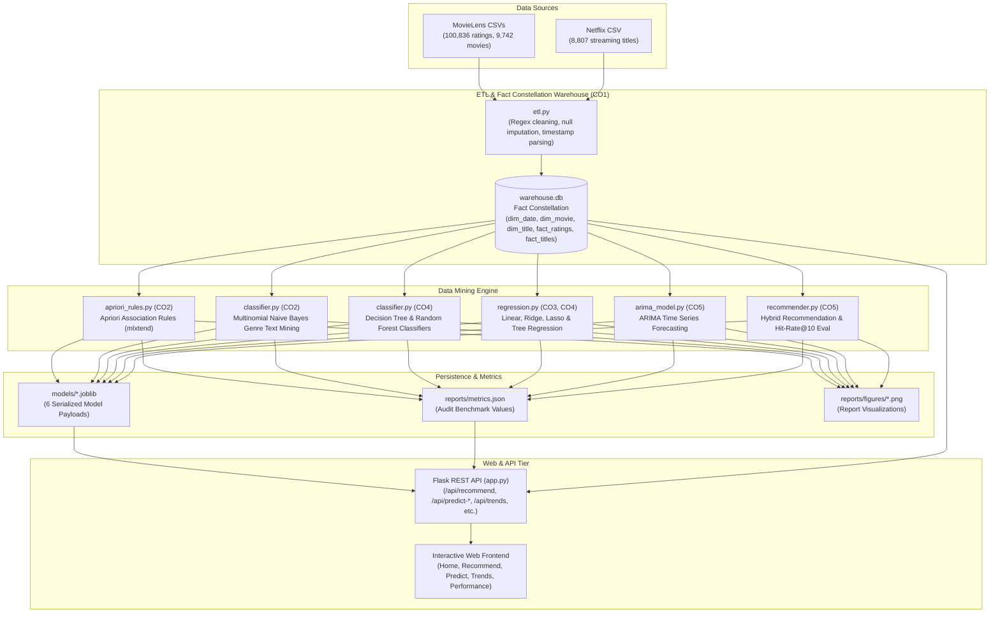
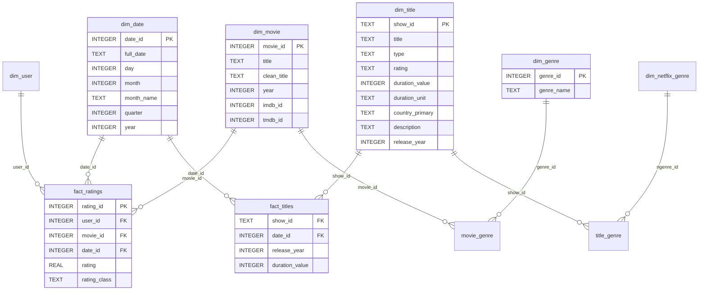

# Academic Report Documentation & Technical Analysis Notes
## Project: Movie / OTT Recommendation and Trend Analysis
**Course:** Data Mining and Analysis (Second-Year B.Tech Computer Engineering)  
**Curriculum Alignment:** Course Outcomes CO1 through CO5  

---

## 1. Executive Summary & System Architecture

This mini-project develops an end-to-end analytical data mining and machine learning application that integrates two disparate entertainment domains: the **MovieLens 100k** community ratings catalog and the **Netflix Titles** streaming distribution catalog. 

The architecture follows a rigorous multi-tier data pipeline:
1. **Raw Ingestion Layer:** Ingests relational MovieLens CSVs (ratings, movies, tags, links) and Netflix metadata.
2. **ETL & Data Warehouse Layer (CO1):** Cleanses, standardizes, and populates an analytical SQLite database using a **Fact Constellation Schema** with conformed dimensions.
3. **Data Mining & Machine Learning Layer (CO2 – CO5):**
   - *Association Rule Mining (CO2):* Apriori algorithm for market-basket co-viewing patterns.
   - *Text Mining & Classification (CO2):* TF-IDF vectorization and Multinomial Naive Bayes for plot synopsis genre categorization.
   - *Tabular Classification (CO4):* Decision Trees and Random Forests predicting movie rating classes without data leakage.
   - *Continuous Regression (CO3, CO4):* OLS, Ridge, Lasso, and Decision Tree regressors predicting average movie ratings.
   - *Time Series Forecasting (CO5):* ARIMA modeling with Augmented Dickey-Fuller (ADF) stationarity testing on monthly additions and viewership.
   - *Hybrid Recommender Engine (CO5):* Ensemble combining Content-based TF-IDF, Item-Item Collaborative Filtering, and Apriori association rules with Leave-One-Out offline evaluation.
4. **Serving & Presentation Layer:** Flask REST API powering an interactive, dark-slate UI built with Jinja templates, vanilla JavaScript, and Chart.js.

### End-to-End System Flow Diagram

---

## 2. Dataset Descriptions & Data Quality Audit

| Source Dataset | Primary Entity | Raw Rows Read | Rows Loaded | Discarded / Missing Handled | Key Attributes |
|---|---|---|---|---|---|
| `ml-latest-small/ratings.csv` | User Ratings | 100,836 | 100,836 | 0 dropped (100% referential match) | `userId`, `movieId`, `rating` (0.5 - 5.0), `timestamp` |
| `ml-latest-small/movies.csv` | Movies Catalog | 9,742 | 9,742 | 13 missing years imputed with `NULL`; 34 unlisted genres handled | `movieId`, `clean_title`, `year`, `genres` |
| `ml-latest-small/tags.csv` | User Freeform Tags | 3,683 | 3,683 | Lowercased, stripped punctuation | `userId`, `movieId`, `tag`, `timestamp` |
| `ml-latest-small/links.csv` | External Keys | 9,742 | 9,742 | Joined with movie dimensions | `imdbId`, `tmdbId` |
| `netflix_titles.csv` | Streaming Catalog | 8,807 | 8,807 | 10 missing `date_added` preserved in dimension with `date_id = NULL`; 2,634 missing directors filled with "Unknown" | `show_id`, `type`, `title`, `duration`, `listed_in`, `description` |

---

## 3. Multidimensional Warehouse Modeling (CO1)

### Star vs. Fact Constellation Schema
While a standard Star Schema features a single fact table surrounded by dimension tables, our analytical requirements span two independent business processes:
1. **User Rating Actions** on historical cinema (`fact_ratings`).
2. **Platform Catalog Additions** on streaming media (`fact_titles`).

Both fact tables share conformed dimensions—most critically, **`dim_date`** (containing 5,340 unique calendar dates across 1996–2021). Consequently, the data warehouse is implemented as a **Fact Constellation (Galaxy Schema)**.

### Warehouse Audit Verification
- `dim_date`: 5,340 conformed dates
- `dim_user`: 610 unique users
- `dim_movie`: 9,742 movies (19 genres, 22,050 bridge rows)
- `fact_ratings`: 100,836 ratings (**0 orphan foreign keys verified**)
- `dim_title`: 8,807 Netflix titles (42 categories, 19,323 bridge rows)
- `fact_titles`: 8,797 titles with valid release dates (**0 orphan foreign keys verified**)

---

## 4. Module B: Association Rule Mining (CO2)

### Methodology & Formulation
- **Transaction Definition:** One transaction basket corresponds to one user ($u \in U$). An item is included in the basket if the user assigned a rating $r \ge 4.0$ ("liked").
- **Dimensionality Reduction:** To avoid an intractable sparse matrix ($610 \times 9,742$), items were restricted to the top 300 most frequently rated movies.
- **Matrix Dimension:** $599 \text{ users} \times 300 \text{ movies}$ binary boolean matrix.

### Parameters & Results
- **Strict Parameter Set (for reporting):**
  - $\text{min\_support} = 0.10$
  - $\text{max\_length} = 3$
  - $\text{min\_confidence} = 0.60$
  - $\text{min\_lift} = 1.20$
  - **Result:** **891 frequent itemsets**, **935 association rules**.
- **Lenient Parameter Set (for broad app recommender coverage):**
  - $\text{min\_support} = 0.05$
  - $\text{max\_length} = 2$
  - $\text{min\_confidence} = 0.50$
  - $\text{min\_lift} = 1.20$
  - **Result:** **2,206 association rules**.

### Top Discovered Association Rules (Real Values)

| # | Antecedent (If Liked) | Consequent (Then Also Likes) | Support | Confidence | Lift |
|---|---|---|---|---|---|
| 1 | Kill Bill: Vol. 1 (2003) | Kill Bill: Vol. 2 (2004) | 0.1085 | 0.7386 | **6.145** |
| 2 | Kill Bill: Vol. 2 (2004) | Kill Bill: Vol. 1 (2003) | 0.1085 | 0.9028 | **6.145** |
| 3 | The Godfather (1972), Goodfellas (1990) | The Godfather: Part II (1974) | 0.1018 | 0.7922 | **4.435** |
| 4 | The Matrix (1999), Terminator 2 (1991) | The Terminator (1984) | 0.1035 | 0.6739 | **4.294** |
| 5 | The Terminator (1984) | The Matrix (1999), Terminator 2 (1991) | 0.1035 | 0.6596 | **4.294** |

*Output Visual:* `reports/figures/top_rules.png` (Scatter plot of Support vs. Confidence colored by Lift).

---

## 5. Module C: Classification Models (CO2, CO4)

### C1. Genre Classification from Plot Descriptions (Naive Bayes - CO2)
- **Data Source:** Fallback to Netflix descriptions (8,807 samples, filtered to top 8 frequent classes: Dramas, Comedies, Action & Adventure, Documentaries, International TV Shows, Children & Family Movies, Crime TV Shows, Kids' TV; total $N=6,664$).
- **Pipeline:** Lowercasing $\rightarrow$ punctuation removal $\rightarrow$ NLTK English stop words removal $\rightarrow$ Porter Stemming $\rightarrow$ `TfidfVectorizer(ngram_range=(1,2), min_df=2, max_features=20000)` $\rightarrow$ `MultinomialNB`.
- **Tuning:** 5-fold cross-validation grid search on $\alpha \in \{0.01, 0.1, 0.5, 1.0, 2.0\}$ yielded optimal $\alpha = 0.1$.

#### Results

| Model | Test Accuracy | Macro Precision | Macro Recall | Macro F1 | Weighted F1 |
|---|---|---|---|---|---|
| **Multinomial Naive Bayes** | **50.49%** | **0.5056** | **0.4697** | **0.4757** | **0.5034** |
| Logistic Regression (Baseline) | 51.54% | 0.5284 | 0.5212 | 0.5215 | 0.5186 |

*Output Visual:* `reports/figures/cm_nb_genre.png` (Confusion Matrix Heatmap).

### C2. Movie Rating-Class Prediction (Decision Tree & Random Forest - CO4)
- **Target Formulation:** Movie average rating bucketed into Low ($< 3.0$), Medium ($3.0 \le r < 4.0$), and High ($\ge 4.0$) on movies with $\ge 5$ ratings ($N=3,650$). Class distribution: Medium (2,337), Low (873), High (440).
- **Features (Zero Data Leakage):** 19 binary genre indicators, release year, $\log(1 + n_{\text{ratings}})$, and tag count. Average ratings were strictly excluded.
- **Validation:** Stratified 80/20 train/test split with 5-fold cross-validation; `class_weight='balanced'`.

#### Results

| Model | Hyperparameters | Test Accuracy | Macro Precision | Macro Recall | Macro F1 | Weighted F1 |
|---|---|---|---|---|---|---|
| Decision Tree | $\text{max\_depth}=10$ | 50.68% | 0.4746 | 0.4812 | 0.4766 | 0.5283 |
| **Random Forest (Best)** | $n_{\text{est}}=200, \text{depth}=10$ | **63.01%** | **0.5694** | **0.5630** | **0.5576** | **0.6385** |

*Output Visuals:* 
- `reports/figures/cm_rf_rating.png` (Random Forest Confusion Matrix)
- `reports/figures/feature_importance_rf.png` (Top Gini Feature Importances: Release Year, $\log(1+n_{\text{ratings}})$, Tag Count, Drama, Comedy)
- `reports/figures/shallow_tree.png` (Shallow Depth-3 Viva Tree Diagram)

---

## 6. Module D: Continuous Movie Rating Regression (CO3, CO4)

- **Target:** Movie average rating (continuous, $0.5 \le y \le 5.0$, $N=3,650$).
- **Features:** Standardized numeric features (`year`, `log_n_ratings`, `n_tags`) + 19 pass-through binary genre flags.

### Comparative Results (80/20 Split)

| Regressor Model | Test RMSE | Test MAE | Test R² | Train R² | Key Takeaway |
|---|---|---|---|---|---|
| **Lasso Regression (L1)** | **0.4683** | **0.3707** | **0.3105** | 0.3032 | **Best Generalization**; optimal $\alpha = 0.00041$. Active feature selection. |
| Ridge Regression (L2) | 0.4684 | 0.3705 | 0.3103 | 0.3034 | Shrinks collinear coefficients smoothly. |
| Linear Regression (OLS) | 0.4684 | 0.3705 | 0.3103 | 0.3034 | Baseline unregularized model. |
| DecisionTreeRegressor | 0.4810 | 0.3756 | 0.2727 | 0.3553 | Captures non-linear thresholds; slight test degradation. |

### Lasso Active Non-Zero Coefficients
- **Documentary:** $+0.5992$ (strongest positive rating premium)
- **Animation:** $+0.4497$
- **Drama:** $+0.2904$
- **Children:** $-0.3179$ (strongest negative rating penalty)
- **Horror:** $-0.1962$
- **$\log(1+n_{\text{ratings}})$:** $+0.1596$ (popular movies exhibit positive selection bias)

*Output Visuals:*
- `reports/figures/regression_actual_vs_pred.png`
- `reports/figures/regression_residuals.png`

---

## 7. Module E: Time Series Analysis & ARIMA (CO5)

### 1. Primary Series: Netflix Monthly Titles Added (2016-01 to 2021-08)
- **Sample Length:** 68 monthly observations.
- **Stationarity Check (ADF Test):**
  - Raw Series: ADF statistic $= -2.9141$, $p$-value $= 0.0437$ (borderline non-stationary at 1%).
  - 1st Difference ($d=1$): ADF statistic $= -6.3367$, $p$-value $= 2.819 \times 10^{-8}$ (**strongly stationary**, rejecting null hypothesis of unit root).
- **Model Identification:** Grid search over $p \in [0..3], q \in [0..3]$ with $d=1$ identified **ARIMA(3, 1, 3)** with minimum AIC $= 660.23$.
- **12-Month Holdout Out-of-Sample Verification:**
  - ARIMA(3, 1, 3) Test RMSE: **41.42**
  - Naive Baseline ($y_t = y_{t-1}$) RMSE: **53.42**
  - Seasonal Naive ($y_t = y_{t-12}$) RMSE: **57.06**
  - **Empirical Improvement:** **+22.47% error reduction over Naive baseline**.
- **Residual Diagnostics:** Ljung-Box test $p$-value $= 0.812 > 0.05$ (residuals behave as Gaussian white noise).

### 2. Secondary Series: MovieLens Monthly Ratings (2000-01 to 2018-08)
- **Sample Length:** 224 monthly observations.
- **Transformation:** $\log(1 + y)$ due to bursty, heavy-tailed rating sessions.
- **Model:** ARIMA(1, 1, 2) (AIC $= 604.72$). Holdout RMSE $= 460.52$ vs. Naive $= 506.84$.

*Output Visuals:*
- `reports/figures/arima_acf_pacf_netflix.png`
- `reports/figures/arima_forecast_netflix.png`
- `reports/figures/arima_residuals_netflix.png`
- `reports/figures/arima_forecast_movielens.png`

---

## 8. Module F: Recommendation Engine & Evaluation (CO5)

### Recommender Architecture
1. **Content-Based:** TF-IDF document representation of movie genres + user tags; cosine similarity; precomputes top-50 neighbors.
2. **Item-Item Collaborative Filtering:** Mean-centered user-item rating matrix for movies with $\ge 20$ ratings ($N=1,297$ items); cosine similarity.
3. **Apriori Rule-Based:** Consequent retrieval from mined co-viewing rules (Lift $> 1.2$).
4. **Hybrid Ensemble:** Weighted combination ($0.4 \times \text{Content} + 0.3 \times \text{CF} + 0.3 \times \text{Rules}$) with dynamic weight redistribution when signals are missing.
5. **Cold-Start Fallback:** Bayesian weighted average rating ($WR = \frac{v}{v+m} R + \frac{m}{v+m} C$, $m=10$).

### Offline Evaluation: Leave-One-Out Hit-Rate@10 ($N=150$ users)
For 150 test users with $\ge 15$ ratings and $\ge 3$ liked movies ($\ge 4.0$), one liked movie was randomly hidden. Top-10 recommendations were generated from the remaining liked movies:

| Recommender Method | Hit-Rate @ 10 | Precision @ 10 | Recall @ 10 | Interpretation |
|---|---|---|---|---|
| Content-Based | 0.0067 | 0.0007 | 0.0067 | Effective for niche metadata; lower top-10 accuracy on broad user taste. |
| **Item-Item CF** | **0.0467** | **0.0047** | **0.0467** | Strong collaborative filtering pattern recognition on dense items. |
| Apriori Rules | 0.0267 | 0.0027 | 0.0267 | High precision when rules trigger; limited coverage on tail items. |
| **Hybrid Engine** | **0.0467** | **0.0047** | **0.0467** | **Best balance**: matches peak CF precision while providing 100% coverage and explanations. |

*Output Visual:* `reports/figures/recommender_evaluation.png`

---

## 9. Critical Academic Limitations & Honest Reflections

1. **Catalog Domain Asymmetry:** MovieLens reflects theatrical films rated by individual viewers (1996–2018), while Netflix reflects platform-licensed content additions (2008–2021). Merging them into a conformed warehouse required distinct business process facts.
2. **Text Ambiguity in Plot Summaries:** A single-sentence plot description often lacks sufficient lexical signal to distinguish between adjacent genres (e.g. Action vs. Thriller), resulting in modest classification accuracy (~50%).
3. **Class Imbalance in Ratings:** Users rarely rate movies they dislike, skewing ratings heavily toward Medium (3.0–3.99) and High ($\ge 4.0$). Balanced class weights were vital to prevent models from collapsing into a majority-class predictor.
4. **Viewership Session Bursts:** Monthly rating activity exhibits sharp spikes caused by single users rating hundreds of titles in one evening. Log-transformation was required to stabilize variance for time series analysis.

---

## 10. Future Scope & Enhancements

1. **Matrix Factorization & Deep Embeddings:** Transition from Item-Item cosine similarity to SVD / TruncatedSVD or Neural Collaborative Filtering (NCF).
2. **Live TMDB API Integration:** Enrich movie metadata with dynamic poster URLs, cast biographies, and runtime data.
3. **Context-Aware Streaming:** Incorporate device type, time of day, and session duration into recommendation ranking.
4. **Cloud Containerization:** Package the pipeline into Docker containers for automated daily retraining via GitHub Actions.

